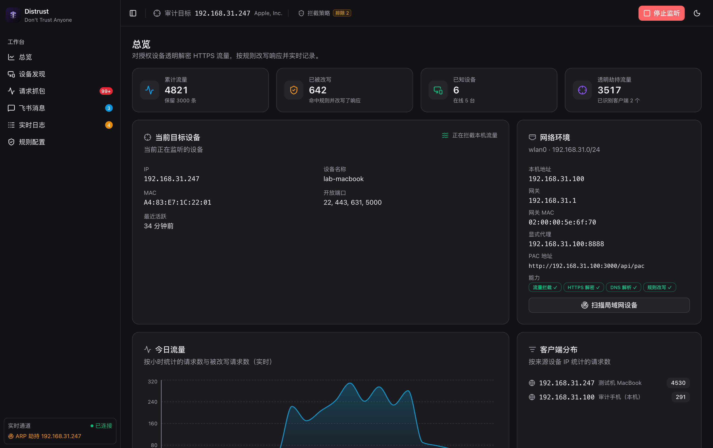
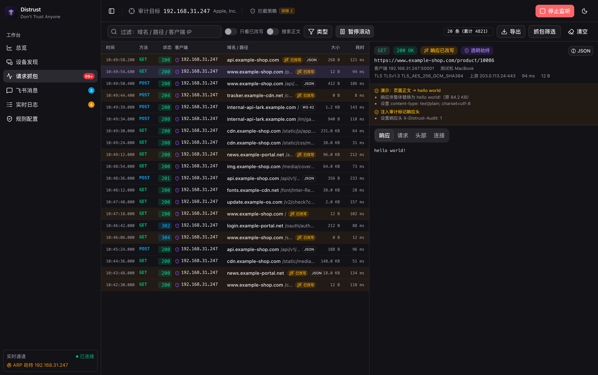
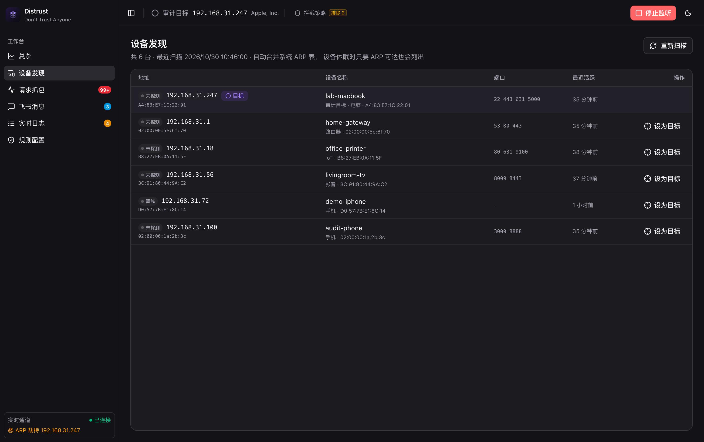
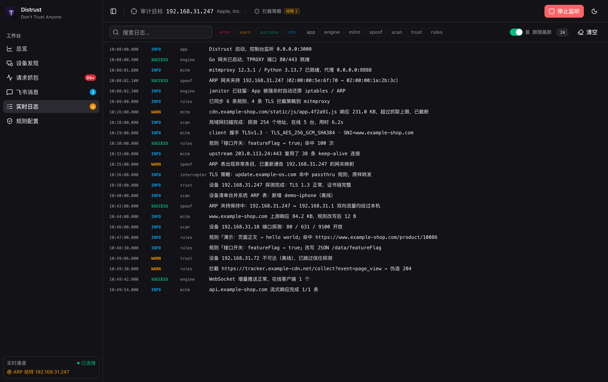
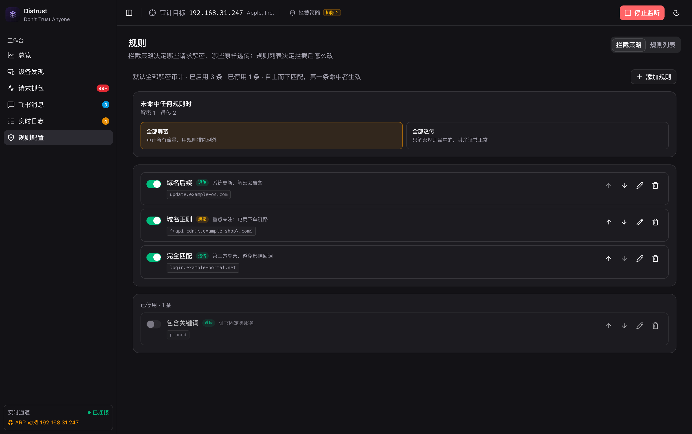
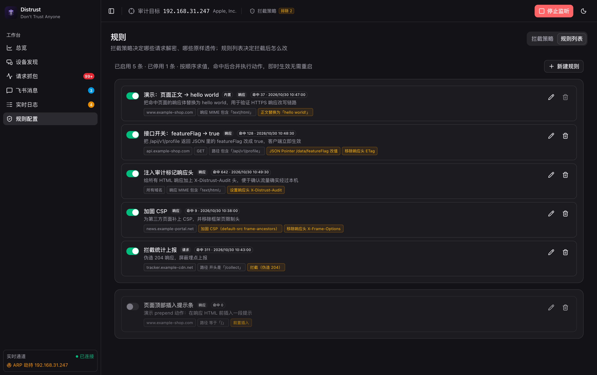
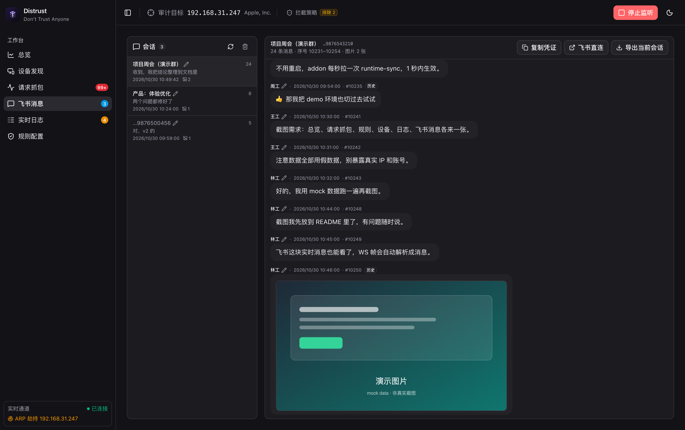
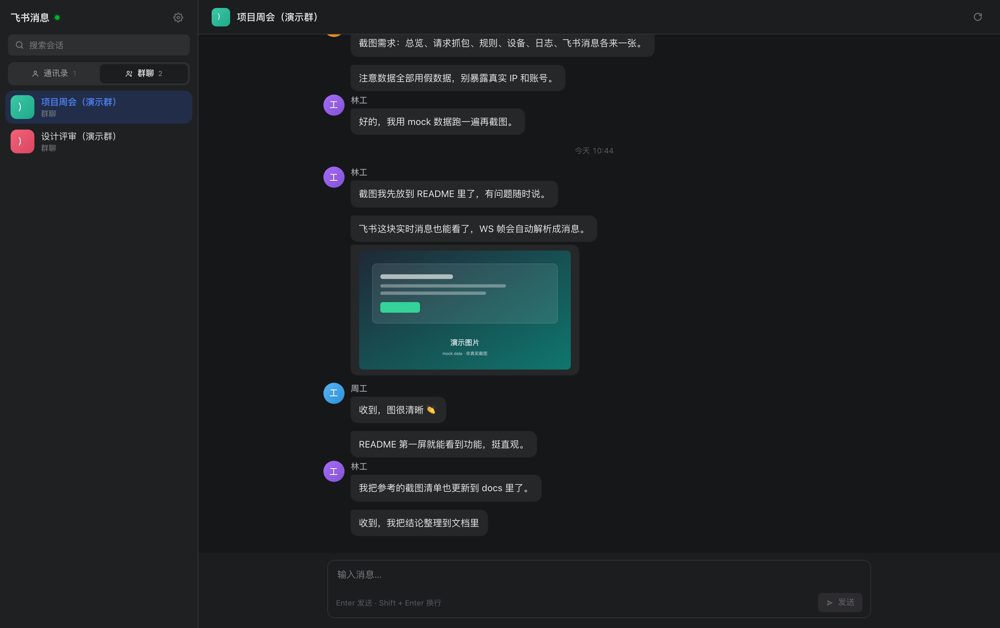

# Distrust

**局域网 HTTPS 请求监控与飞书消息实时监听**

## 简介

2026 年 10 月，有人发现印度 CA eMudhra 旗下 emSign 的 8 张中间证书私钥，在生成时随机性严重不足，导致拿公开证书就能直接算出来。各大浏览器第一时间封禁了这些证书，Go、Python、Rust 也很快发了新版。

但更新需要时间，大部分人的软件还是旧的：macOS 自带的 `curl`、`git` 根本不检查证书是否被吊销；Go、`certifi` 这类自带信任库的客户端得重新编译才行；Electron 应用要等上游发版。

Distrust 就诞生在这个背景下：它能监控并篡改那些尚未更新的旧应用发出的 HTTPS 请求，其中就包括飞书这类即时通信软件。换句话说，和你连同一个 WiFi 的人，可以随意查看你的飞书消息。

这个事件给我们的启示是：一定要保持系统和应用经常更新，不要随便连接陌生的 WiFi 热点。

## 亮点

- **💻 目标设备无感**：目标设备上什么都不用配置，旧应用 HTTPS 请求完全裸奔。
- **✏️ 响应实时改写**：不仅支持查看 HTTPS 请求内容，还能构造替换任意响应内容。
- **💬 飞书消息审计**：支持查看实时消息和历史消息，文字和图片都能看，也能向任意会话发消息。

## 预览

| 总览 | 请求抓包 |
|---|---|
|  |  |

| 设备发现 | 实时日志 |
|---|---|
|  |  |

| 规则 · 拦截策略 | 规则 · 规则列表 |
|---|---|
|  |  |

| 飞书消息 | 飞书客户端 |
|---|---|
|  |  |

## 免责声明

> [!WARNING]
> 出于安全考虑，本仓库不包含任何实现代码，只保留说明、截图和相关文档。 
> eMudhra 相关 PoC 可参考：[idootop/decert](https://github.com/idootop/decert)。

本项目仅用于安全研究、学习和已获授权的审计测试。ARP 劫持和证书解密会直接影响被审计设备和他人的网络，未经授权在任何设备或网络上使用均可能违法，后果由使用者自负。作者不对任何滥用行为负责。

## License

MIT License © 2026-PRESENT [Del Wang](https://del.wang)
